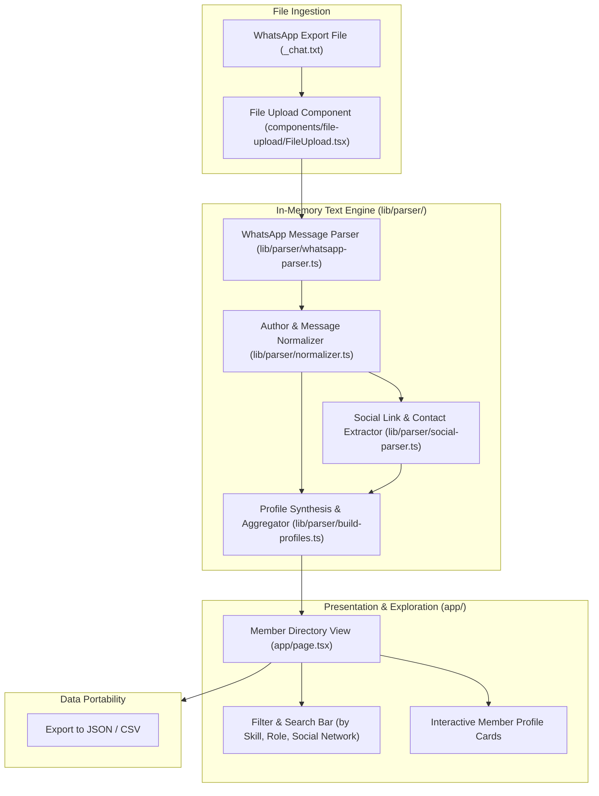
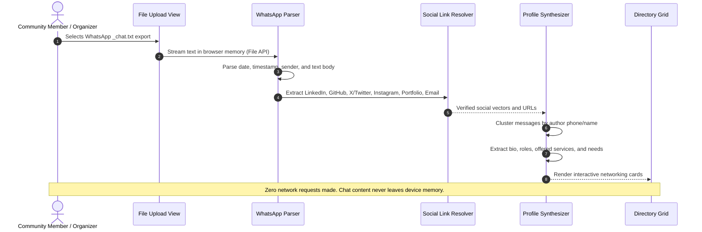

# 🏛️ WhatsApp Networking Hub Architecture & System Topology

Privacy-first client-side web application that transforms unstructured WhatsApp group chat exports into a structured, searchable networking directory with automated social link extraction and member profile synthesis. Built with Next.js 15, TypeScript, Tailwind CSS, and Vitest. 100% offline in-browser execution with zero telemetry.

---

## 1. Technology Stack

| Layer | Technology | Details |
| :--- | :--- | :--- |
| **Framework** | Next.js 15 (Static Export) | Client-rendered web application deployable to Vercel or GitHub Pages |
| **Language** | TypeScript 5 (Strict Mode) | Full type safety for chat lines, social links, and structured profiles |
| **Regex & Parsing Engine** | Custom Text & Link Parsers | Fast regex normalization supporting iOS and Android chat export date formats |
| **Styling** | Tailwind CSS v3 | Modern dark/light responsive interface |
| **Testing** | Vitest | Comprehensive test coverage over timestamp variants, emoji names, and URLs |

---

## 2. System Topology & Component Graph



---

## 3. In-Browser Data Processing Lifecycle



---

## 4. Directory Structure & Module Breakdown

```
whatsapp-networking-hub/
├── app/                      # Next.js App Router entrypoints
│   ├── globals.css           # Tailwind base styles and theme
│   ├── layout.tsx            # HTML shell, fonts, and metadata
│   └── page.tsx              # Main single-page application and directory
├── components/               # UI components
│   └── file-upload/          # Drag-and-drop file ingestion zone
│       └── FileUpload.tsx    # File API reader with format detection
├── lib/                      # Core parsing and domain logic
│   ├── parser/
│   │   ├── whatsapp-parser.ts# Regex timestamp and message line extractor
│   │   ├── normalizer.ts     # Strips system notifications (encryption, calls)
│   │   ├── social-parser.ts  # Regex pattern matching for 8+ social platforms
│   │   ├── profile-parser.ts # Heuristic role and introduction detector
│   │   ├── build-profiles.ts # Groups, scores, and merges member messages
│   │   └── index.ts          # Unified parsing pipeline facade
│   └── types/
│       └── index.ts          # TypeScript interfaces (Message, Profile, SocialLink)
├── tests/                    # Vitest unit test suite
│   ├── whatsapp-parser.test.ts # Android & iOS timestamp and multilines
│   ├── social-parser.test.ts   # URL extraction and normalization assertions
│   ├── profile-parser.test.ts  # Role and contact heuristic tests
│   └── build-profiles.test.ts  # Multi-message author merging tests
├── tailwind.config.ts        # Tailwind design system configuration
└── package.json              # Project dependencies and test scripts
```
